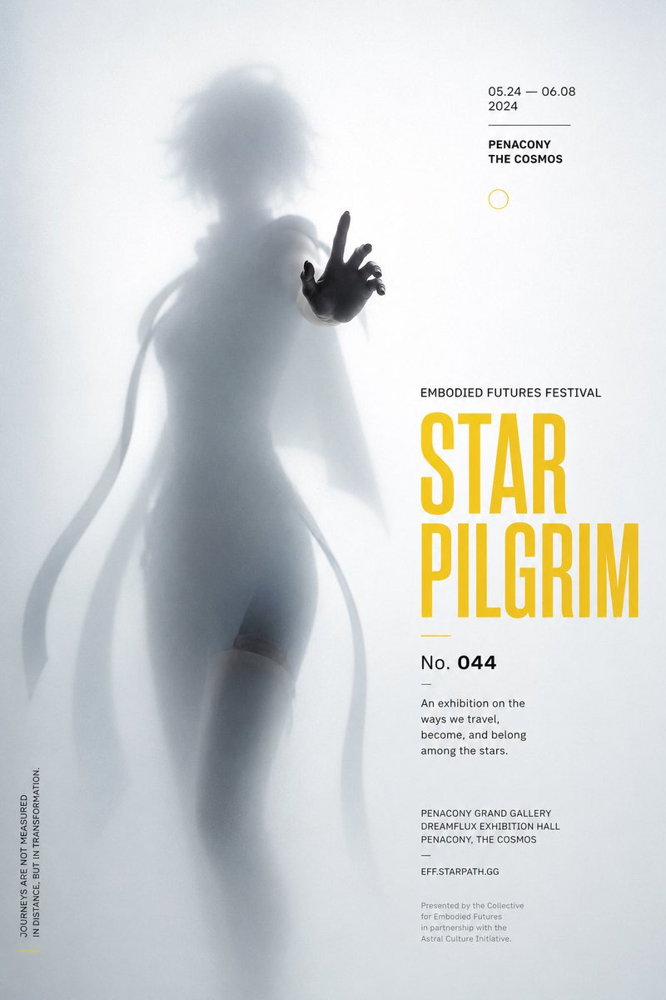
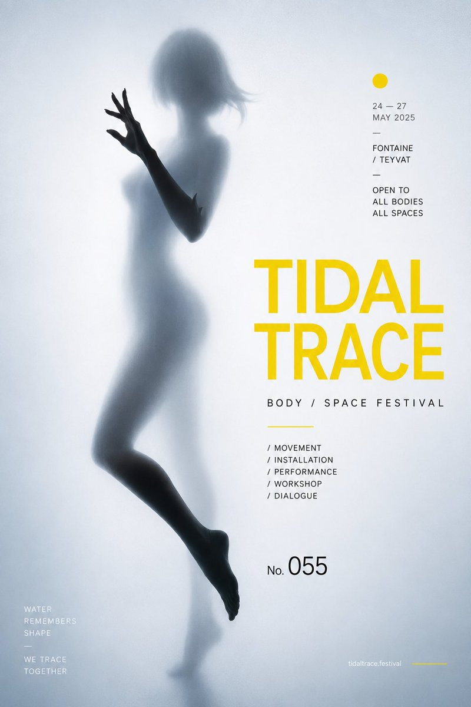

# Reference Images / 参考图

These are operator-selected public preview images from the YouMind skill
`生成磨砂玻璃效果剪影艺术海报`. They are external calibration material for
this Pattern, not OVG-generated cases or outputs.

这些图片是从 YouMind 公开技能“生成磨砂玻璃效果剪影艺术海报”中人工筛选的预览图。
它们只作为本 Pattern 的外部校准素材，不是 OVG 生成的案例，也不是范式的唯一标准答案。

## Selected previews / 已选预览

### `youmind-frosted-silhouette-01.webp`

### `youmind-frosted-silhouette-02.webp`

### `youmind-frosted-silhouette-03.webp`

### `youmind-frosted-silhouette-04.webp`

## Why they belong / 保留原因

- A single silhouette remains the first read before the frosted treatment is inspected.
- Clear, softened, and translucent regions create semantic reveal levels rather than a full-frame blur.
- Near-white space, geometric alignment, and one restrained accent color keep the editorial structure legible.
- The set shows variation in subject and layout while retaining the same quiet frosted grammar.

## Source and rights / 来源与权利

- Public detail page: [YouMind skill](https://youmind.com/~skills/01a05ceb-6172-7c97-b503-fb560ecfd412)
- Listed author: saga su
- Retrieved from the publicly visible preview gallery on 2026-09-02.
- These files are retained as attributed external calibration material. Confirm reuse rights before publishing them outside this repository; do not describe them as OVG-owned or OVG-generated work.
