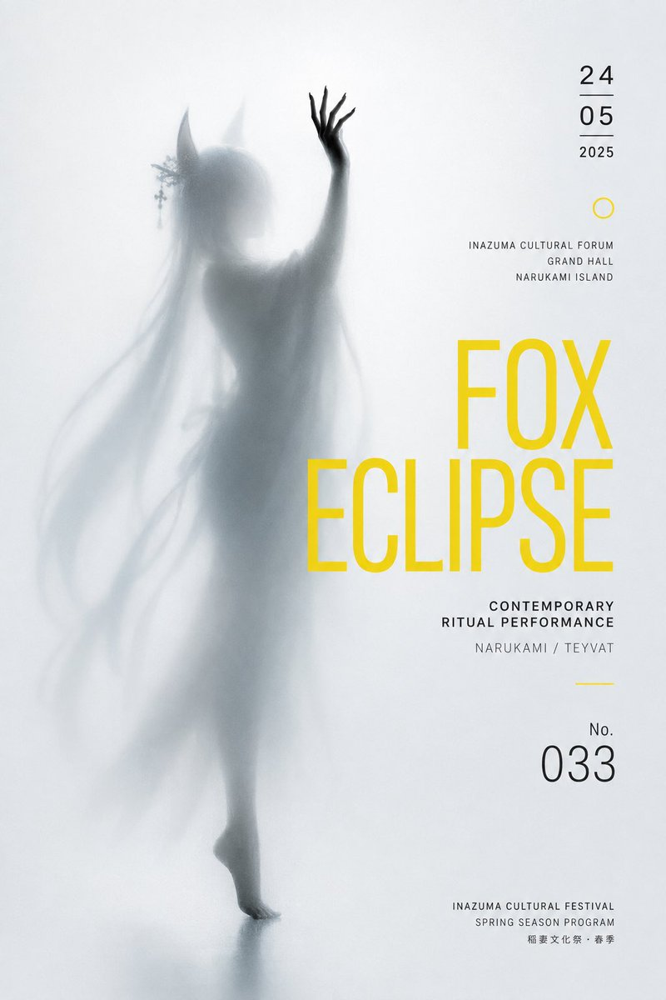
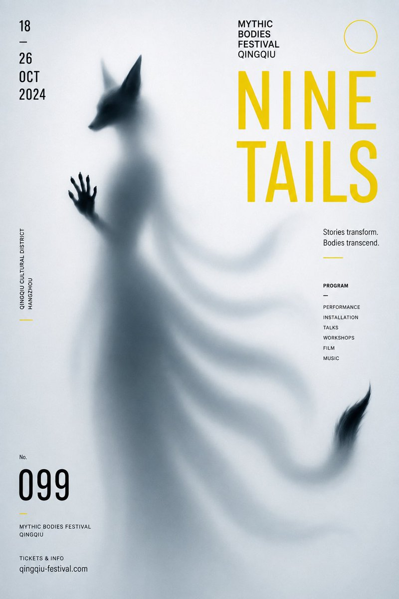

# Reference Images / 参考图

These are operator-selected calibration images for this Pattern. They are
external material, not OVG-generated cases or outputs.

这些图片是人工筛选的外部校准素材，不是 OVG 生成的案例，也不是范式的唯一标准答案。

## Selected previews / 已选预览

### `frosted-silhouette-01.webp`

### `frosted-silhouette-02.webp`

### `frosted-silhouette-03.webp`

### `frosted-silhouette-04.webp`

## Why they belong / 保留原因

- A single silhouette remains the first read before the frosted treatment is inspected.
- Clear, softened, and translucent regions create semantic reveal levels rather than a full-frame blur.
- Near-white space, geometric alignment, and one restrained accent color keep the editorial structure legible.
- The set shows variation in subject and layout while retaining the same quiet frosted grammar.

## Usage boundary / 使用边界

These files remain external calibration material. Confirm reuse rights before
publishing them outside this repository; do not describe them as OVG-owned or
OVG-generated work.

这些文件仅作为外部校准素材。发布到仓库之外前必须确认复用权利，也不要将它们描述为 OVG 所有或 OVG 生成。
