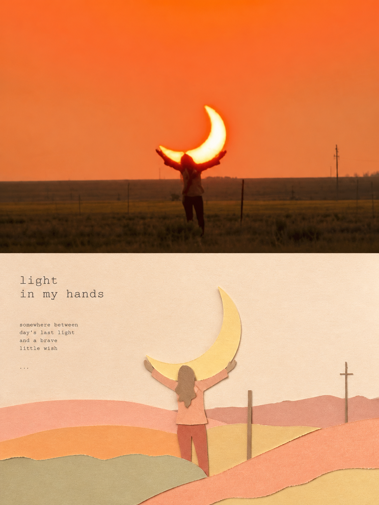

# Reference Images / 参考图

These are operator-selected public preview images from the YouMind skill
`小小东 x 纸雕 x 拼贴 x P077`. They are external calibration material for this
Pattern, not OVG-generated cases or outputs.

这些图片是从 YouMind 公开技能“小小东 x 纸雕 x 拼贴 x P077”中人工筛选的预览图。
它们只作为本 Pattern 的外部校准素材，不是 OVG 生成的案例，也不是范式的唯一标准答案。

## Selected previews / 已选预览

### `youmind-paper-sculpture-01.webp`

### `youmind-paper-sculpture-02.webp`

### `youmind-paper-sculpture-03.webp`

### `youmind-paper-sculpture-04.webp`

## Why they belong / 保留原因

- Cut-paper contours and ordered planes make the subject readable before texture is noticed.
- Occlusion, bridges, and shallow contact shadows carry the scene relationship.
- The restrained pastel family is derived from the subject instead of being a fixed candy palette.
- The set demonstrates variation while keeping the tactile, warm editorial collage grammar intact.

## Source and rights / 来源与权利

- Public detail page: [YouMind skill](https://youmind.com/~skills/01a05794-c02f-741d-8c82-f72819c7934a)
- Listed author: 小小东
- Retrieved from the publicly visible preview gallery on 2026-09-02.
- These files are retained as attributed external calibration material. Confirm reuse rights before publishing them outside this repository; do not describe them as OVG-owned or OVG-generated work.
