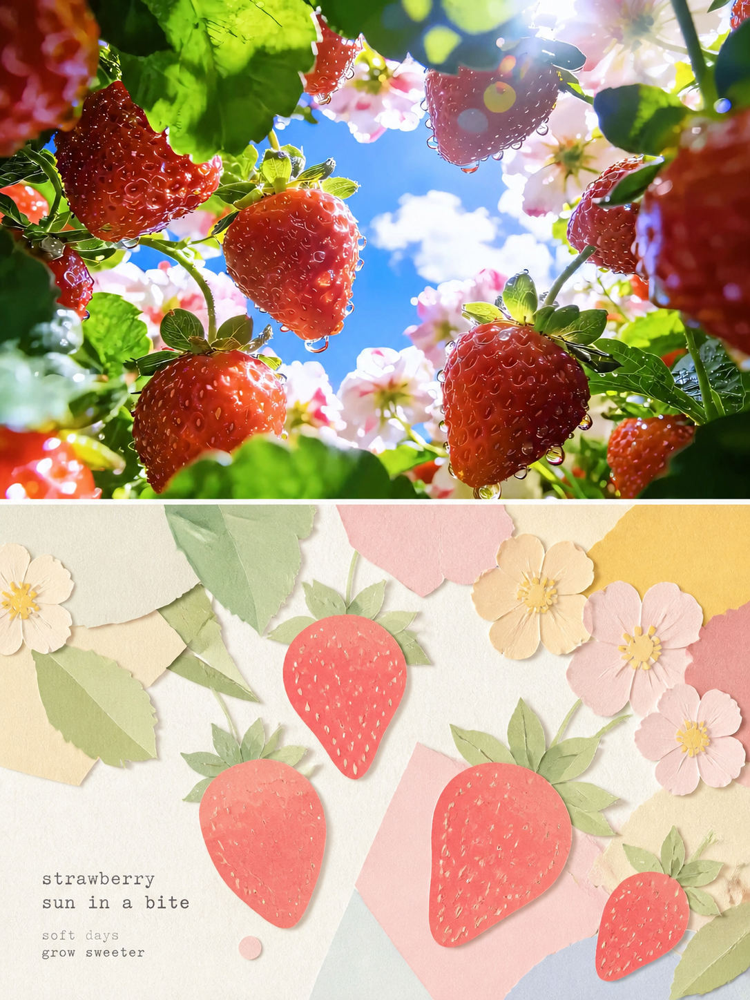
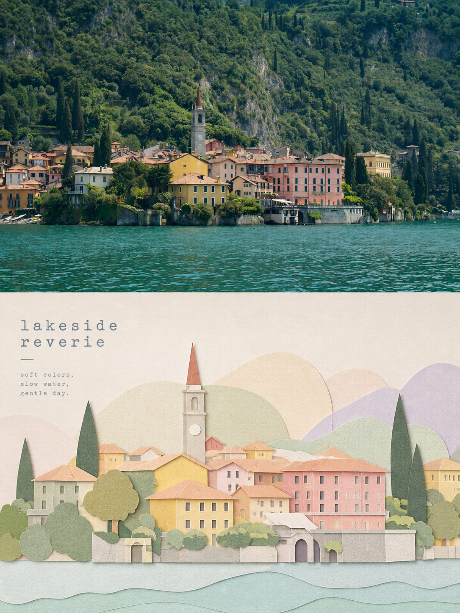

# Reference Images / 参考图

These are operator-selected calibration images for this Pattern. They are
external material, not OVG-generated cases or outputs.

这些图片是人工筛选的外部校准素材，不是 OVG 生成的案例，也不是范式的唯一标准答案。

## Selected previews / 已选预览

### `paper-sculpture-01.webp`

### `paper-sculpture-02.webp`

### `paper-sculpture-03.webp`

### `paper-sculpture-04.webp`

## Why they belong / 保留原因

- Cut-paper contours and ordered planes make the subject readable before texture is noticed.
- Occlusion, bridges, and shallow contact shadows carry the scene relationship.
- The restrained pastel family is derived from the subject instead of being a fixed candy palette.
- The set demonstrates variation while keeping the tactile, warm editorial collage grammar intact.

## Usage boundary / 使用边界

These files remain external calibration material. Confirm reuse rights before
publishing them outside this repository; do not describe them as OVG-owned or
OVG-generated work.

这些文件仅作为外部校准素材。发布到仓库之外前必须确认复用权利，也不要将它们描述为 OVG 所有或 OVG 生成。
