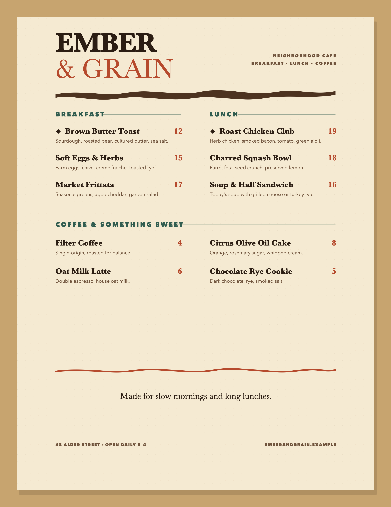

# Reference Images / 参考图

These images are operator-approved calibration references for the pattern. They
show reusable hierarchy and print behavior, not a fixed restaurant identity or
renderer implementation.

这些图片是经过人工确认的 Pattern 校准参考。它们说明可复用的层级和印刷行为，不代表固定餐厅身份或固定渲染器实现。

## `warm-cafe-signature.webp`



Source:

```text
Original fictional menu composed for OVG pattern validation.
Deterministic SVG layout -> 2550 x 3300 PNG -> lossless WebP.
```

Why it belongs:

- the restaurant name anchors the composition within one second;
- section labels remain clearly below the name and above menu items;
- item names and tabular prices form stable, easy-to-scan pairs;
- one hand-marked divider carries the Warm Cafe signature;
- the warm paper field, muted descriptions, and restrained accent colors read
  as a printable hospitality artifact rather than a web interface.

保留原因：

- 餐厅名能在一秒内成为构图锚点；
- 章节标签低于餐厅名，同时明显高于菜品；
- 菜品名和等宽价格形成稳定、易扫读的配对；
- 只用一种手刷分隔线承载 Warm Cafe 的风格签名；
- 暖纸底色、弱化描述和克制强调色让它像可打印的餐饮成品，而不是网页界面。

What it does not prove:

- every menu should use this exact restaurant name, copy, coordinates, or
  amount of whitespace;
- the other style directions or dense-layout switch have been validated;
- host fonts are acceptable for reproducible production output;
- CJK, right-to-left, or editable menu requirements are covered.

参考不能证明：

- 每份菜单都应复用同一餐厅名、文案、坐标或留白量；
- 其他风格方向或高密度切换已经完成验证；
- 生产环境可以依赖宿主字体而不打包字体文件；
- 中文、从右到左语言或可编辑菜单需求已经被覆盖。

Rights / public safety:

```text
Original OVG validation artifact. All restaurant content is fictional. No
third-party image, logo, trademark, or private material is included.
```
