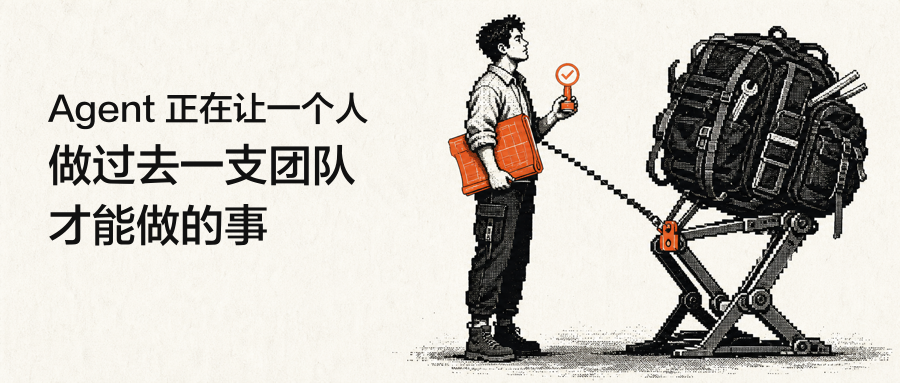

# Agent Personal Capacity / Agent 改变个人能力边界

This reviewed pair uses the same article claim and `900x383` delivery ratio. It
records why surface resemblance was insufficient and why restoring the
pattern's editorial structure worked.

这组已审案例使用相同文章主张和 `900x383` 交付比例。它记录了为什么只像表面不够，以及恢复 Pattern 的编辑结构后为什么成立。

Primary source / 正文真源：

```text
ganfan-media/articles/2026-08-24-agent-changes-personal-capacity/article.md
```

Core correction / 核心修正：

```text
Agent 正在让一个人做过去一支团队才能做的事。
```

## Accepted / 通过


Why it passes:

- a strong frame and bottom band establish an intentional editorial plate;
- the headline, transition arrow, before/after states, and evidence modules form one argument;
- scale changes separate first read, central mechanism, and supporting proof;
- orange marks the transition and decision points instead of decorating the whole image.

通过原因：

- 粗边框和底部条带形成了明确的编辑图版；
- 标题、转化箭头、前后状态与证据模块共同证明一个判断；
- 第一眼信息、核心机制与辅助证据存在清楚的尺度差；
- 橙色只标记转化和判断节点，没有铺成装饰色。

## Rejected: Sparse Spot Illustration / 拒绝：稀疏单幅插画



Why it fails:

- the left side is a detached title field while the right side is one isolated illustration;
- the frame, bands, evidence modules, and editorial scale rhythm are absent;
- low density and fixed empty space contradict this pattern's composition families;
- pixel edges, halftone, black, white, and orange preserve only the surface costume.

失败原因：

- 左侧是与场景脱离的标题区，右侧只是一个孤立插画；
- 边框、条带、证据模块和编辑尺度节奏都消失了；
- 低密度和固定大留白与这套 Pattern 的构图家族冲突；
- 像素边缘、网点、黑白橙只保留了表面装扮。

## Reusable Lesson / 可复用结论

The successful correction did not hard-code this article's objects. It restored
a supported composition family, let the title participate in the structure,
and used the article's own before/after evidence inside that family. Future
topics may change every object and word while preserving those functional
relationships.

这次修正没有把文章里的具体物件写死进风格。它恢复了受支持的构图家族，让标题参与结构，再把正文自己的前后证据放进这个家族。未来主题可以替换全部物件和文字，只保留这些功能关系。

This pair does not prove that every technical topic needs a before/after scene.
It proves that this pattern requires one supported editorial structure; use
another pattern when the job genuinely needs a sparse spot illustration.

这组案例不能证明所有技术主题都该做前后对比。它只证明本 Pattern 必须保留一种受支持的编辑结构；任务真正需要稀疏单幅插画时，应改选其他 Pattern。
