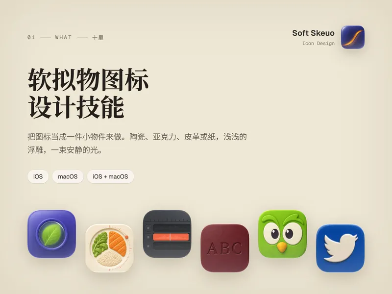
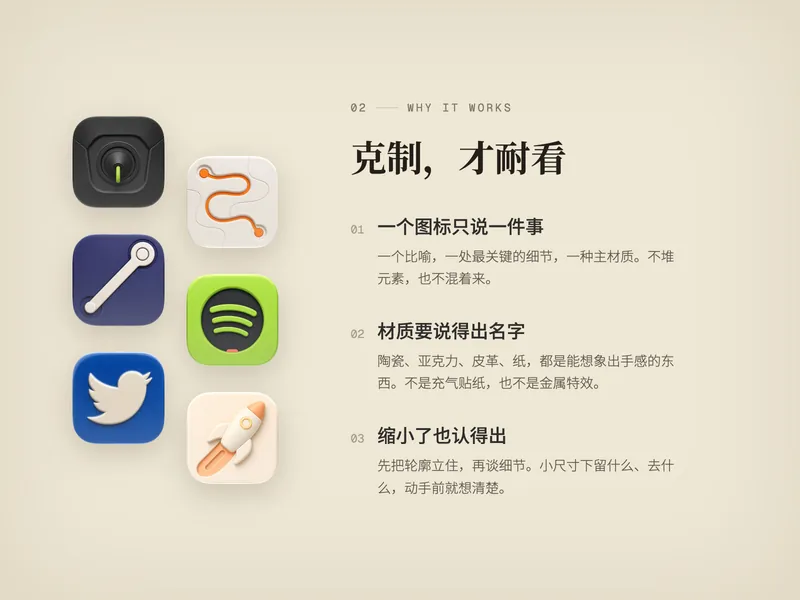

# Reference Images / 参考图

These are operator-selected public preview images from the YouMind skill
`轻拟物 App图标设计`. They are external calibration material for this Pattern,
not OVG-generated cases or outputs.

这些图片是从 YouMind 公开技能“轻拟物 App图标设计”中人工筛选的预览图。
它们只作为本 Pattern 的外部校准素材，不是 OVG 生成的案例，也不是范式的唯一标准答案。

## Selected previews / 已选预览

### `youmind-soft-2-5d-icon-01.webp`

### `youmind-soft-2-5d-icon-02.webp`

### `youmind-soft-2-5d-icon-03.webp`

### `youmind-soft-2-5d-icon-04.webp`

## Why they belong / 保留原因

- Each square mark has one dominant silhouette that survives thumbnail inspection.
- Shallow overlap or relief explains depth without thick extrusion, chrome, or wet gloss.
- Broad, restrained color fields and soft light read as a product identity rather than a generic 3D object.
- The set covers multiple icon subjects while keeping the same low-density 2.5D construction.

## Source and rights / 来源与权利

- Public detail page: [YouMind skill](https://youmind.com/~skills/019fdf3a-1735-7571-a80f-b4265a910d0b)
- Listed author: 十里
- Retrieved from the publicly visible preview gallery on 2026-09-02.
- These files are retained as attributed external calibration material. Confirm reuse rights before publishing them outside this repository; do not describe them as OVG-owned or OVG-generated work.
