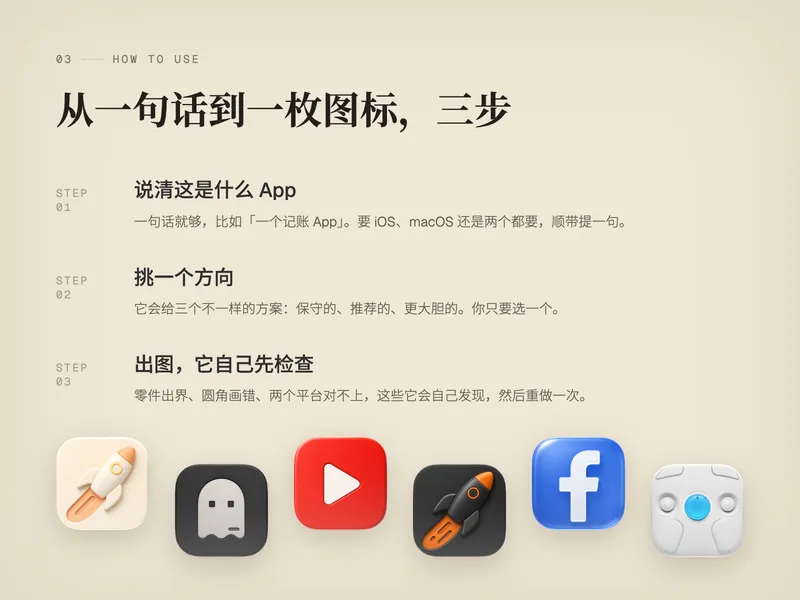
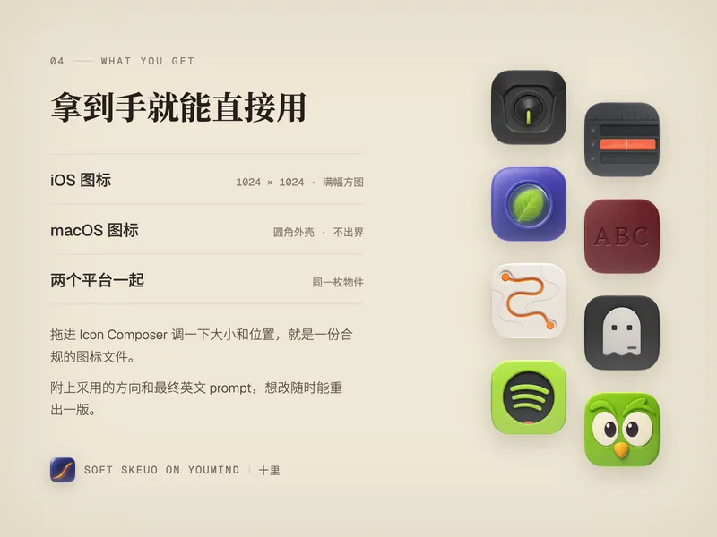

# Reference Images / 参考图

These are operator-selected calibration images for this Pattern. They are
external material, not OVG-generated cases or outputs.

这些图片是人工筛选的外部校准素材，不是 OVG 生成的案例，也不是范式的唯一标准答案。

## Selected previews / 已选预览

### `soft-2-5d-icon-01.webp`

### `soft-2-5d-icon-02.webp`

### `soft-2-5d-icon-03.webp`

### `soft-2-5d-icon-04.webp`

## Why they belong / 保留原因

- Each square mark has one dominant silhouette that survives thumbnail inspection.
- Shallow overlap or relief explains depth without thick extrusion, chrome, or wet gloss.
- Broad, restrained color fields and soft light read as a product identity rather than a generic 3D object.
- The set covers multiple icon subjects while keeping the same low-density 2.5D construction.

## Usage boundary / 使用边界

These files remain external calibration material. Confirm reuse rights before
publishing them outside this repository; do not describe them as OVG-owned or
OVG-generated work.

这些文件仅作为外部校准素材。发布到仓库之外前必须确认复用权利，也不要将它们描述为 OVG 所有或 OVG 生成。
