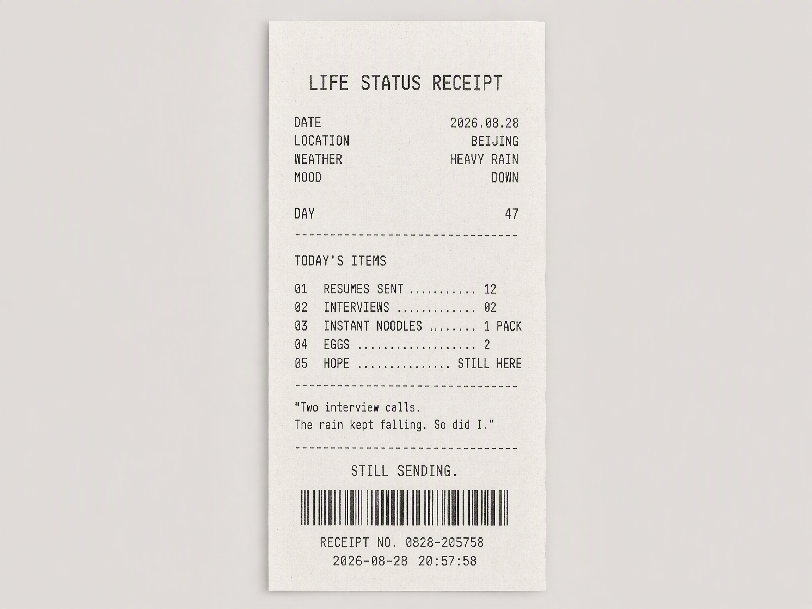

# Reference Images / 参考图

These are operator-selected calibration images for this Pattern. They are
external material, not OVG-generated cases or outputs.

这些图片是人工筛选的外部校准素材，不是 OVG 生成的案例，也不是范式的唯一标准答案。

## Selected previews / 已选预览

### `thermal-receipt-01.webp`

### `thermal-receipt-02.webp`

## Why they belong / 保留原因

- The narrow, continuous receipt silhouette is readable before paper texture is noticed.
- Field order, monospaced hierarchy, and deliberate blank space make the record scannable.
- Warm thermal paper and uneven charcoal printing stay subordinate to the supplied content.
- Short observational lines land with dry human restraint instead of advertising copy.

## Usage boundary / 使用边界

These files remain external calibration material. Confirm reuse rights before
publishing them outside this repository; do not describe them as OVG-owned or
OVG-generated work.

这些文件仅作为外部校准素材。发布到仓库之外前必须确认复用权利，也不要将它们描述为 OVG 所有或 OVG 生成。
