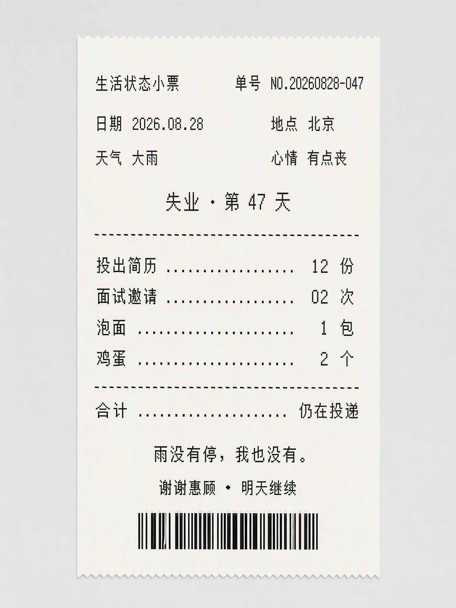

# Reference Images / 参考图

These are operator-selected public preview images from the YouMind skill
`热敏小票海报生成器`. They are external calibration material for this Pattern,
not OVG-generated cases or outputs.

这些图片是从 YouMind 公开技能“热敏小票海报生成器”中人工筛选的预览图。
它们只作为本 Pattern 的外部校准素材，不是 OVG 生成的案例，也不是范式的唯一标准答案。

## Selected previews / 已选预览

### `youmind-thermal-receipt-01.webp`

### `youmind-thermal-receipt-02.webp`

## Why they belong / 保留原因

- The narrow, continuous receipt silhouette is readable before paper texture is noticed.
- Field order, monospaced hierarchy, and deliberate blank space make the record scannable.
- Warm thermal paper and uneven charcoal printing stay subordinate to the supplied content.
- Short observational lines land with dry human restraint instead of advertising copy.

## Source and rights / 来源与权利

- Public detail page: [YouMind skill](https://youmind.com/~skills/01a04867-1831-70f1-a60d-99a50cf3be0c)
- Listed author: Peter Yuan
- Retrieved from the publicly visible preview gallery on 2026-09-02.
- These files are retained as attributed external calibration material. Confirm reuse rights before publishing them outside this repository; do not describe them as OVG-owned or OVG-generated work.
